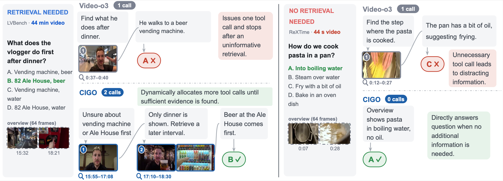
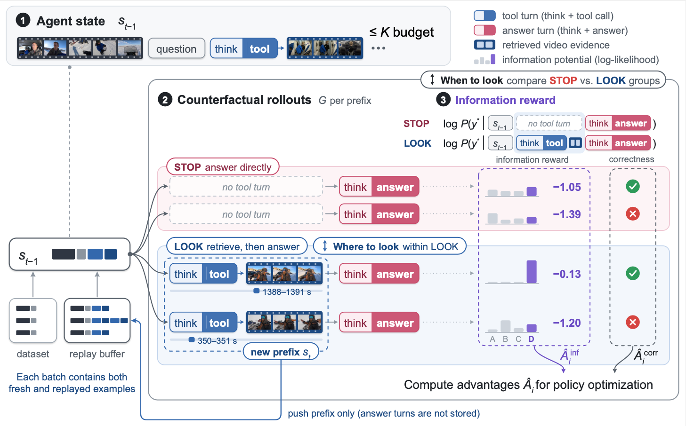

# CIGO: Teaching Video Agents When and Where to Look with Counterfactual Information Gain

## Introduction

Video agents can retrieve visual evidence with tools while they reason, but each retrieval costs thousands of
context tokens and irrelevant frames can mislead the answer. **CIGO** (Counterfactual Information Gain Policy
Optimization) trains an agent to decide *when to look* (whether a tool call is needed) and *where to look* (which
interval to retrieve). This repository contains the RL training code, the evaluation code for the six benchmarks of
the paper, and the configuration of every reported run.



## Method

From the same reasoning prefix, CIGO samples counterfactual continuations that either answer directly (STOP) or
issue one tool call before answering (LOOK). Each continuation is rewarded by its correctness and by its information
potential, the frozen initial policy's log-likelihood of the ground-truth answer, so STOP vs. LOOK teaches *when* to look and the
spread within LOOK teaches *where*.



## Environment Setup

```bash
conda env create -f environment.yml && conda activate cigo
pip install flash-attn==2.8.3 --no-build-isolation
pip install --no-deps -e verl -e .
```

Tested with CUDA 12.8, PyTorch 2.8.0, vLLM 0.11.0 and transformers 4.57.1. Frame extraction needs `ffmpeg`.

## Data Sourcing

We follow [ThinkingWithVideos](https://github.com/zhang9302002/ThinkingWithVideos) to obtain the videos and
annotations.

| Split | Sources |
|---|---|
| Training | [LongVideo-Reason](https://github.com/NVlabs/Long-RL), [CG-Bench](https://github.com/CG-Bench/CG-Bench), [Video-R1](https://github.com/tulerfeng/Video-R1), [Charades-STA](https://github.com/jiyanggao/TALL) |
| Evaluation | [Video-MME](https://github.com/MME-Benchmarks/Video-MME), [MLVU](https://github.com/JUNJIE99/MLVU), [LVBench](https://github.com/zai-org/LVBench), [LongVideoBench](https://github.com/longvideobench/LongVideoBench), [Video-MMMU](https://github.com/EvolvingLMMs-Lab/VideoMMMU), [Charades-STA](https://github.com/jiyanggao/TALL) |

Frames are extracted at 2 fps:

```bash
python -m cigo.data.extract_frames --input-dir <videos> --output-dir $CIGO_DATA_ROOT/<dataset>/video_14400frames_fps2
```

## Data Filtering

The training set is filtered in two stages ([data/README.md](data/README.md)).

| Stage | Rule |
|---|---|
| 1. Blind filter | 4 answers without the video; questions answered above chance are removed |
| 2. Answerability filter | 8 answers with the video; questions answered all correctly or all incorrectly are removed |

```bash
python -m cigo.data.blind_filter --model $CIGO_MODEL_DIR/Qwen3-VL-8B-Thinking \
    --input candidates.json --output nonblind.json --work-dir work/blind --num-gpus 4
python -m cigo.data.answerability_filter --model $CIGO_MODEL_DIR/Qwen3-VL-8B-Thinking \
    --input nonblind.json --frame-dir $CIGO_DATA_ROOT/<dataset>/video_14400frames_fps2 \
    --output filtered.json --work-dir work/answerability --num-gpus 4
```

Expected layout:

```text
data/train/                           # the paper's training set (data/README.md)
├── longvideo_reason.json             # LongVideo-Reason, MCQ   1,449
├── cg_bench.json                     # CG-Bench, MCQ           1,608
├── video_r1.json                     # Video-R1, MCQ             303
└── charades_sta.json                 # Charades-STA, TG        1,440

$CIGO_DATA_ROOT/
├── longvideo-reason/  cgbench_mini/  charades/
│   └── video_14400frames_fps2/<video_id>/*.jpg
├── videomme/          test_set_grpo.json    2,700   + video_14400frames_fps2/
├── mlvu/              dev_set_grpo.json     2,174   + video_14400frames_fps2/
├── lvbench/           test_set_grpo.json    1,549   + video_14400frames_fps2/
├── longvideobench/    val_set_grpo.json     1,337   + video_14400frames_fps2/
├── videommmu/         test_set_grpo.json      879   + video_14400frames_fps2/
└── charades/          test_set_grpo.json    3,720   + video_14400frames_fps2/
```

## RL Training

We implement RL training with [verl](https://github.com/verl-project/verl).

```bash
export CIGO_DATA_ROOT=<frames and annotations> CIGO_MODEL_DIR=<dir with Qwen3-VL-8B-Thinking>
export CIGO_OUTPUT_DIR=<checkpoints> CIGO_EXPORT_DIR=<merged models>

# scripts/train.sh <arm> <run name> [hydra overrides]
bash scripts/train.sh cigo cigo_8b      # 4 GPUs, 300 steps
```

Training uses 4 GPUs with 96 GB each and logs to Weights & Biases (set `WANDB_API_KEY`, or pass
`trainer.logger=[console]`). The last checkpoint is merged into a Hugging Face model at `$CIGO_EXPORT_DIR/<run name>`.

| Flag                                                    | Default  | Meaning                                |
| ------------------------------------------------------- | -------- | -------------------------------------- |
| `algorithm.prefix_replay.beta_ur`                       | 0.5      | weight λ of the information reward     |
| `algorithm.prefix_replay.max_depth`                     | 3        | tool-call budget K                     |
| `algorithm.prefix_replay.fresh_root_ratio`              | 0.5      | share of fresh questions per batch     |
| `algorithm.prefix_replay.capacity`, `ttl_steps`         | 1600, 25 | replay buffer size and prefix lifetime |
| `actor_rollout_ref.rollout.n`                           | 8        | group size G                           |
| `data.train_batch_size`                                 | 32       | prefixes per step                      |
| `actor_rollout_ref.rollout.single_turn_response_length` | 4096     | tokens per turn                        |
| `trainer.total_training_steps`                          | 300      | training steps                         |

## Evaluation

```bash
export CIGO_DATA_ROOT=<frames and annotations> CIGO_EVAL_DIR=<results>

# with tool: up to 3 calls of 64 frames
bash scripts/eval.sh $CIGO_EXPORT_DIR/cigo_8b configs/eval/main_table.yaml

# without tool: Qwen3-VL-8B-Thinking baseline
bash scripts/eval.sh $CIGO_MODEL_DIR/Qwen3-VL-8B-Thinking configs/eval/base_notool.yaml
```

Video-MME, MLVU, LVBench and LongVideoBench use 1024 initial frames at 224×224; Video-MMMU and Charades-STA use 256
frames at 384×384. Results are written to `$CIGO_EVAL_DIR/<model>/` and summarized in one table.

## Acknowledgment

We thank the authors of open-source projects [Qwen3-VL](https://github.com/QwenLM/Qwen3-VL), [verl](https://github.com/verl-project/verl)
and [ThinkingWithVideos](https://github.com/zhang9302002/ThinkingWithVideos) for releasing their code.